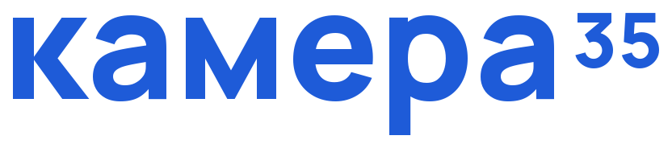

# Камера35 — удалённая поддержка

Windows x64 клиент на базе RustDesk OSS **1.5.3** с логотипом и цветами Камера35.
ID-сервер и relay заранее настроены на **rust.techline.cc**.

[Сборки и загрузка EXE](https://github.com/ikrider/kamera35-client/actions/workflows/kamera35-windows.yml)
· [Параметры брендинга](.github/kamera35/config.json)
· [Инструкция](.github/kamera35/README.ru.md)

Откройте успешную сборку **Kamera35 Windows** и скачайте артефакт
**Kamera35-1.5.3-windows-x64**. Распакуйте архив и запустите
`Kamera35-1.5.3-windows-x64.exe`. Установку можно выполнить внутри клиента.
EXE собирается без цифровой подписи издателя; контрольная сумма находится
рядом с ним в `SHA256SUMS.txt`.

## Настройки

| Параметр | Значение |
|---|---|
| Название приложения / службы | Kamera35 |
| ID-сервер | rust.techline.cc:21116 |
| Relay | rust.techline.cc:21117 |
| Публичный ключ | `25kidpPDyok3dWp+Y7uYu4MNGcurc5uxyA71RFAcm2M=` |
| Язык по умолчанию | Русский |
| Основные цвета | #1E5BD8, #1F6BFF, #F3F6FB |

Подключение и подтверждение доступа используют исходную логику RustDesk.
Постоянный пароль доступа пользователь задаёт самостоятельно, если он нужен.
Настройки Kamera35 хранятся в отдельном профиле приложения.

## Повторная сборка

В **Actions → Kamera35 Windows → Run workflow** запускается сборка Windows x64.
Она загружает официальный коммит RustDesk
[`95cca3f661f635b3cc85c04935fe8d96d8f432ef`](https://github.com/rustdesk/rustdesk/tree/95cca3f661f635b3cc85c04935fe8d96d8f432ef)
(тег 1.5.3), инициализирует закреплённый подмодуль `hbb_common` и применяет
[скрипт брендинга](.github/kamera35/apply.py). Адрес сервера, ключ и имя задаются
в [config.json](.github/kamera35/config.json). Изменения этих файлов запускают
новую сборку автоматически.

## Область изменений исходников

- `libs/hbb_common/src/config.rs`: имя приложения, серверы, публичный ключ,
  русский язык и отключение официального автообновления по умолчанию, чтобы
  сохранялся брендированный клиент.
- `flutter/lib/common.dart`: акцентные цвета, фон и границы.
- `flutter/lib/desktop/widgets/titlebar_widget.dart`: цвета верхней панели.
- `flutter/lib/desktop/pages/desktop_home_page.dart`: цвет границы главного окна.
- `flutter/windows/runner/Runner.rc`: название продукта и описание EXE.
- Иконки Windows и трея, изображения логотипа в `flutter/assets`.

Каждое изменение применяется при сборке к закреплённой версии исходников;
скрипт останавливается, если ожидаемые строки больше не совпадают.

RustDesk: [официальный проект](https://github.com/rustdesk/rustdesk),
[документация сборки](https://rustdesk.com/docs/en/dev/build/),
[лицензия AGPL-3.0](LICENCE). Авторские уведомления RustDesk сохранены.
Manrope в логотипе — [SIL Open Font License](.github/kamera35/Manrope-OFL.txt).
